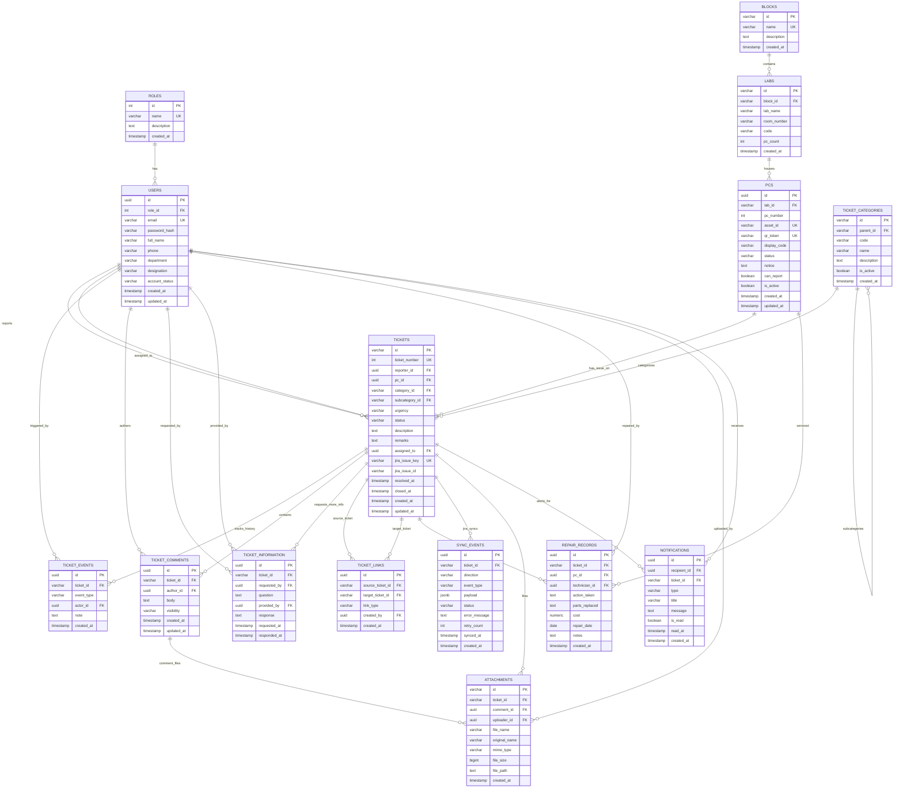

# CampusCare Database Entity-Relationship (ER) Diagram

The following Mermaid diagram illustrates the 15 core entities of `campuscare_db`, their attributes, primary keys, foreign keys, and cardinalities.

