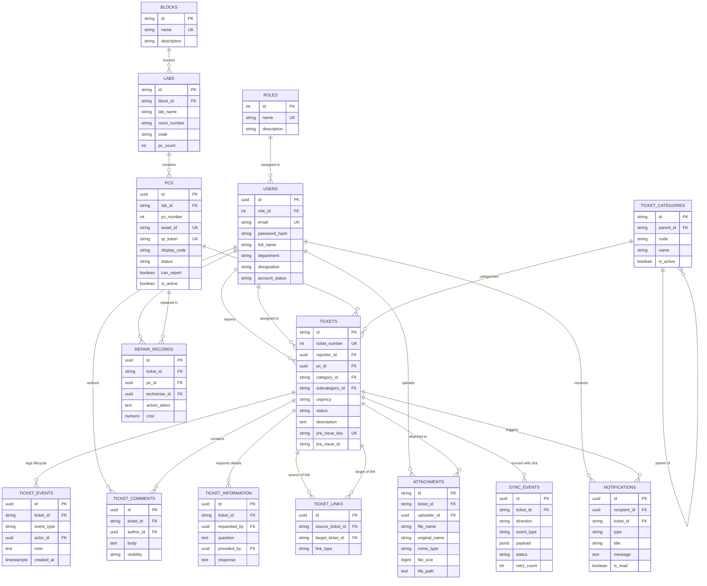

# CampusCare – PostgreSQL Database Schema Specification

**Database Name:** `campuscare_db`  
**RDBMS Engine:** PostgreSQL 14+ / 19  
**Specification Version:** 1.0.0  
**Author:** Member 2 (Backend & Database Architecture)  
**Last Updated:** November 2026  

---

## 1. Architectural Overview & Design Principles

The CampusCare database schema is engineered specifically for institutional stability, high data integrity, strict auditability, and clear boundaries between college user interfaces and external IT support systems.

### Core Architectural Decisions:
1. **Third Normal Form (3NF) Normalization:** All operational data is normalized to avoid redundancy and update anomalies while utilizing indexed foreign-key joins for efficient reporting.
2. **Decoupled Identifiers:**
   - User-facing business IDs (`LAB-1001` for tickets, `522/A/1` for PC positions) provide immediate human context.
   - Internal UUIDs (`gen_random_uuid()`) protect against sequential enumeration attacks.
   - External integration keys (`JSM-1042` for Jira Service Management) are stored in dedicated columns, preventing vendor lock-in.
3. **Immutable Lifecycle Audit Trails:** All ticket lifecycle transitions, status changes, technician notes, and sync operations are recorded as append-only records in `ticket_events` and `sync_events`.
4. **Referential Integrity & Safe Deletions:**
   - Deletion of foundational master data (rooms, users, PCs) uses `ON DELETE RESTRICT` to preserve historical integrity.
   - Transient notifications and link mappings use `ON DELETE CASCADE` where appropriate.
   - PCs support logical soft deletion (`is_active = false`), allowing decommissioned workstations to remain linked to historical repair reports.
5. **Data Isolation & Privacy:** SQL query structures enforce row-level boundary checks so that faculty members can only view their own ticket narratives while seeing generic "Under Maintenance" notices for peer reports.

---

## 2. Entity-Relationship (ER) Diagram



---

## 3. Complete DDL Schema Definition

```sql
-- ==============================================================================
-- CampusCare – College Lab IT Support System
-- PostgreSQL Database Schema: campuscare_db
-- ==============================================================================

CREATE EXTENSION IF NOT EXISTS "pgcrypto";

-- 1. ROLES TABLE
CREATE TABLE IF NOT EXISTS roles (
    id SERIAL PRIMARY KEY,
    name VARCHAR(50) UNIQUE NOT NULL,
    description TEXT,
    created_at TIMESTAMPTZ NOT NULL DEFAULT CURRENT_TIMESTAMP
);

-- 2. USERS TABLE
CREATE TABLE IF NOT EXISTS users (
    id UUID PRIMARY KEY DEFAULT gen_random_uuid(),
    role_id INT NOT NULL REFERENCES roles(id) ON DELETE RESTRICT,
    email VARCHAR(255) UNIQUE NOT NULL,
    password_hash VARCHAR(255) NOT NULL,
    full_name VARCHAR(150) NOT NULL,
    phone VARCHAR(25),
    department VARCHAR(100),
    designation VARCHAR(100),
    avatar_url TEXT,
    account_status VARCHAR(20) NOT NULL DEFAULT 'ACTIVE' 
        CHECK (account_status IN ('ACTIVE', 'PENDING', 'SUSPENDED', 'DEACTIVATED')),
    created_at TIMESTAMPTZ NOT NULL DEFAULT CURRENT_TIMESTAMP,
    updated_at TIMESTAMPTZ NOT NULL DEFAULT CURRENT_TIMESTAMP
);

-- 3. BLOCKS TABLE
CREATE TABLE IF NOT EXISTS blocks (
    id VARCHAR(50) PRIMARY KEY,
    name VARCHAR(100) UNIQUE NOT NULL,
    description TEXT,
    created_at TIMESTAMPTZ NOT NULL DEFAULT CURRENT_TIMESTAMP
);

-- 4. LABS TABLE (Rooms)
CREATE TABLE IF NOT EXISTS labs (
    id VARCHAR(50) PRIMARY KEY,
    block_id VARCHAR(50) NOT NULL REFERENCES blocks(id) ON DELETE RESTRICT,
    lab_name VARCHAR(100) NOT NULL,
    room_number VARCHAR(20) NOT NULL,
    code VARCHAR(10) NOT NULL,
    pc_count INT NOT NULL DEFAULT 0 CHECK (pc_count >= 0),
    created_at TIMESTAMPTZ NOT NULL DEFAULT CURRENT_TIMESTAMP,
    CONSTRAINT uq_block_room UNIQUE (block_id, room_number)
);

-- 5. PCS TABLE
CREATE TABLE IF NOT EXISTS pcs (
    id UUID PRIMARY KEY DEFAULT gen_random_uuid(),
    lab_id VARCHAR(50) NOT NULL REFERENCES labs(id) ON DELETE RESTRICT,
    pc_number INT NOT NULL CHECK (pc_number > 0),
    asset_id VARCHAR(64) UNIQUE,
    qr_token VARCHAR(128) UNIQUE NOT NULL,
    display_code VARCHAR(50) NOT NULL,
    status VARCHAR(30) NOT NULL DEFAULT 'WORKING' 
        CHECK (status IN ('WORKING', 'UNDER_MAINTENANCE', 'NOT_IN_SERVICE')),
    notice TEXT,
    can_report BOOLEAN NOT NULL DEFAULT true,
    is_active BOOLEAN NOT NULL DEFAULT true,
    created_at TIMESTAMPTZ NOT NULL DEFAULT CURRENT_TIMESTAMP,
    updated_at TIMESTAMPTZ NOT NULL DEFAULT CURRENT_TIMESTAMP,
    CONSTRAINT uq_lab_pc_number UNIQUE (lab_id, pc_number)
);

-- 6. TICKET CATEGORIES TABLE
CREATE TABLE IF NOT EXISTS ticket_categories (
    id VARCHAR(50) PRIMARY KEY,
    parent_id VARCHAR(50) REFERENCES ticket_categories(id) ON DELETE RESTRICT,
    code VARCHAR(50) NOT NULL,
    name VARCHAR(100) NOT NULL,
    description TEXT,
    is_active BOOLEAN NOT NULL DEFAULT true,
    created_at TIMESTAMPTZ NOT NULL DEFAULT CURRENT_TIMESTAMP
);

-- 7. TICKETS TABLE
CREATE TABLE IF NOT EXISTS tickets (
    id VARCHAR(50) PRIMARY KEY,
    ticket_number SERIAL UNIQUE,
    reporter_id UUID NOT NULL REFERENCES users(id) ON DELETE RESTRICT,
    pc_id UUID NOT NULL REFERENCES pcs(id) ON DELETE RESTRICT,
    category_id VARCHAR(50) NOT NULL REFERENCES ticket_categories(id) ON DELETE RESTRICT,
    subcategory_id VARCHAR(50) REFERENCES ticket_categories(id) ON DELETE RESTRICT,
    urgency VARCHAR(20) NOT NULL DEFAULT 'LOW' 
        CHECK (urgency IN ('LOW', 'MEDIUM', 'HIGH', 'CRITICAL')),
    status VARCHAR(30) NOT NULL DEFAULT 'SUBMITTED' 
        CHECK (status IN ('SUBMITTED', 'ACKNOWLEDGED', 'IN_PROGRESS', 'WAITING_FOR_INFO', 'FIXED', 'AWAITING_VERIFICATION', 'CLOSED', 'REOPENED')),
    description TEXT NOT NULL,
    remarks TEXT,
    assigned_to UUID REFERENCES users(id) ON DELETE SET NULL,
    jira_issue_key VARCHAR(50) UNIQUE,
    jira_issue_id VARCHAR(100),
    resolved_at TIMESTAMPTZ,
    closed_at TIMESTAMPTZ,
    created_at TIMESTAMPTZ NOT NULL DEFAULT CURRENT_TIMESTAMP,
    updated_at TIMESTAMPTZ NOT NULL DEFAULT CURRENT_TIMESTAMP
);

-- 8. TICKET EVENTS TABLE (Audit Log)
CREATE TABLE IF NOT EXISTS ticket_events (
    id UUID PRIMARY KEY DEFAULT gen_random_uuid(),
    ticket_id VARCHAR(50) NOT NULL REFERENCES tickets(id) ON DELETE RESTRICT,
    event_type VARCHAR(50) NOT NULL CHECK (event_type IN (
        'SUBMITTED', 'ACKNOWLEDGED', 'IN_PROGRESS', 'WAITING_FOR_INFO',
        'FIXED', 'AWAITING_VERIFICATION', 'VERIFIED', 'CLOSED', 'REOPENED',
        'COMMENT_ADDED', 'INFO_PROVIDED', 'ASSIGNED', 'SYNC_SUCCESS', 'SYNC_FAILED'
    )),
    actor_id UUID REFERENCES users(id) ON DELETE SET NULL,
    note TEXT,
    created_at TIMESTAMPTZ NOT NULL DEFAULT CURRENT_TIMESTAMP
);

-- 9. TICKET COMMENTS TABLE
CREATE TABLE IF NOT EXISTS ticket_comments (
    id UUID PRIMARY KEY DEFAULT gen_random_uuid(),
    ticket_id VARCHAR(50) NOT NULL REFERENCES tickets(id) ON DELETE RESTRICT,
    author_id UUID NOT NULL REFERENCES users(id) ON DELETE RESTRICT,
    body TEXT NOT NULL,
    visibility VARCHAR(20) NOT NULL DEFAULT 'PUBLIC' 
        CHECK (visibility IN ('PUBLIC', 'INTERNAL')),
    created_at TIMESTAMPTZ NOT NULL DEFAULT CURRENT_TIMESTAMP,
    updated_at TIMESTAMPTZ NOT NULL DEFAULT CURRENT_TIMESTAMP
);

-- 10. TICKET INFORMATION TABLE
CREATE TABLE IF NOT EXISTS ticket_information (
    id UUID PRIMARY KEY DEFAULT gen_random_uuid(),
    ticket_id VARCHAR(50) NOT NULL REFERENCES tickets(id) ON DELETE RESTRICT,
    requested_by UUID NOT NULL REFERENCES users(id) ON DELETE RESTRICT,
    question TEXT NOT NULL,
    provided_by UUID REFERENCES users(id) ON DELETE SET NULL,
    response TEXT,
    requested_at TIMESTAMPTZ NOT NULL DEFAULT CURRENT_TIMESTAMP,
    responded_at TIMESTAMPTZ
);

-- 11. TICKET LINKS TABLE
CREATE TABLE IF NOT EXISTS ticket_links (
    id UUID PRIMARY KEY DEFAULT gen_random_uuid(),
    source_ticket_id VARCHAR(50) NOT NULL REFERENCES tickets(id) ON DELETE RESTRICT,
    target_ticket_id VARCHAR(50) NOT NULL REFERENCES tickets(id) ON DELETE RESTRICT,
    link_type VARCHAR(30) NOT NULL 
        CHECK (link_type IN ('DUPLICATE_OF', 'RELATES_TO', 'BLOCKS', 'DEPENDS_ON')),
    created_by UUID REFERENCES users(id) ON DELETE SET NULL,
    created_at TIMESTAMPTZ NOT NULL DEFAULT CURRENT_TIMESTAMP,
    CONSTRAINT chk_no_self_link CHECK (source_ticket_id <> target_ticket_id),
    CONSTRAINT uq_ticket_link UNIQUE (source_ticket_id, target_ticket_id, link_type)
);

-- 12. REPAIR RECORDS TABLE
CREATE TABLE IF NOT EXISTS repair_records (
    id UUID PRIMARY KEY DEFAULT gen_random_uuid(),
    ticket_id VARCHAR(50) REFERENCES tickets(id) ON DELETE SET NULL,
    pc_id UUID NOT NULL REFERENCES pcs(id) ON DELETE RESTRICT,
    technician_id UUID NOT NULL REFERENCES users(id) ON DELETE RESTRICT,
    action_taken TEXT NOT NULL,
    parts_replaced TEXT,
    cost NUMERIC(10, 2) NOT NULL DEFAULT 0.00 CHECK (cost >= 0),
    repair_date DATE NOT NULL DEFAULT CURRENT_DATE,
    notes TEXT,
    created_at TIMESTAMPTZ NOT NULL DEFAULT CURRENT_TIMESTAMP
);

-- 13. SYNC EVENTS TABLE (Jira Outbound Queue)
CREATE TABLE IF NOT EXISTS sync_events (
    id UUID PRIMARY KEY DEFAULT gen_random_uuid(),
    ticket_id VARCHAR(50) NOT NULL REFERENCES tickets(id) ON DELETE RESTRICT,
    direction VARCHAR(20) NOT NULL 
        CHECK (direction IN ('OUTBOUND_TO_JIRA', 'INBOUND_FROM_JIRA')),
    event_type VARCHAR(50) NOT NULL,
    payload JSONB NOT NULL DEFAULT '{}',
    status VARCHAR(20) NOT NULL DEFAULT 'PENDING' 
        CHECK (status IN ('PENDING', 'SUCCESS', 'FAILED', 'RETRY')),
    error_message TEXT,
    retry_count INT NOT NULL DEFAULT 0 CHECK (retry_count >= 0),
    synced_at TIMESTAMPTZ,
    created_at TIMESTAMPTZ NOT NULL DEFAULT CURRENT_TIMESTAMP
);

-- 14. ATTACHMENTS TABLE
CREATE TABLE IF NOT EXISTS attachments (
    id VARCHAR(50) PRIMARY KEY,
    ticket_id VARCHAR(50) NOT NULL REFERENCES tickets(id) ON DELETE RESTRICT,
    comment_id UUID REFERENCES ticket_comments(id) ON DELETE SET NULL,
    uploader_id UUID NOT NULL REFERENCES users(id) ON DELETE RESTRICT,
    file_name VARCHAR(255) NOT NULL,
    original_name VARCHAR(255) NOT NULL,
    mime_type VARCHAR(100) NOT NULL,
    file_size BIGINT NOT NULL CHECK (file_size > 0),
    file_path TEXT NOT NULL,
    created_at TIMESTAMPTZ NOT NULL DEFAULT CURRENT_TIMESTAMP
);

-- 15. NOTIFICATIONS TABLE
CREATE TABLE IF NOT EXISTS notifications (
    id UUID PRIMARY KEY DEFAULT gen_random_uuid(),
    recipient_id UUID NOT NULL REFERENCES users(id) ON DELETE CASCADE,
    ticket_id VARCHAR(50) REFERENCES tickets(id) ON DELETE CASCADE,
    type VARCHAR(50) NOT NULL CHECK (type IN (
        'TICKET_SUBMITTED', 'TICKET_ACKNOWLEDGED', 'INFO_REQUESTED',
        'TICKET_FIXED', 'VERIFICATION_PENDING', 'TICKET_CLOSED',
        'TICKET_REOPENED', 'SYSTEM'
    )),
    title VARCHAR(200) NOT NULL,
    message TEXT NOT NULL,
    is_read BOOLEAN NOT NULL DEFAULT false,
    read_at TIMESTAMPTZ,
    created_at TIMESTAMPTZ NOT NULL DEFAULT CURRENT_TIMESTAMP
);
```

---

## 4. Performance Indexes

```sql
-- Foreign key and lookup optimization
CREATE INDEX IF NOT EXISTS idx_users_role_id ON users(role_id);
CREATE INDEX IF NOT EXISTS idx_users_email ON users(email);
CREATE INDEX IF NOT EXISTS idx_labs_block_id ON labs(block_id);
CREATE INDEX IF NOT EXISTS idx_pcs_lab_id ON pcs(lab_id);
CREATE INDEX IF NOT EXISTS idx_pcs_qr_token ON pcs(qr_token);
CREATE INDEX IF NOT EXISTS idx_pcs_asset_id ON pcs(asset_id);
CREATE INDEX IF NOT EXISTS idx_tickets_reporter_id ON tickets(reporter_id);
CREATE INDEX IF NOT EXISTS idx_tickets_pc_id ON tickets(pc_id);
CREATE INDEX IF NOT EXISTS idx_tickets_status ON tickets(status);
CREATE INDEX IF NOT EXISTS idx_tickets_jira_issue_key ON tickets(jira_issue_key);
CREATE INDEX IF NOT EXISTS idx_ticket_events_ticket_id ON ticket_events(ticket_id);
CREATE INDEX IF NOT EXISTS idx_ticket_comments_ticket_id ON ticket_comments(ticket_id);
CREATE INDEX IF NOT EXISTS idx_ticket_info_ticket_id ON ticket_information(ticket_id);
CREATE INDEX IF NOT EXISTS idx_ticket_links_source ON ticket_links(source_ticket_id);
CREATE INDEX IF NOT EXISTS idx_ticket_links_target ON ticket_links(target_ticket_id);
CREATE INDEX IF NOT EXISTS idx_repair_records_pc_id ON repair_records(pc_id);
CREATE INDEX IF NOT EXISTS idx_repair_records_ticket_id ON repair_records(ticket_id);
CREATE INDEX IF NOT EXISTS idx_sync_events_ticket_id ON sync_events(ticket_id, status);
CREATE INDEX IF NOT EXISTS idx_attachments_ticket_id ON attachments(ticket_id);
CREATE INDEX IF NOT EXISTS idx_notifications_recipient ON notifications(recipient_id, is_read);
```

---

## 5. Automated Triggers

```sql
CREATE OR REPLACE FUNCTION trigger_set_timestamp()
RETURNS TRIGGER AS $$
BEGIN
  NEW.updated_at = CURRENT_TIMESTAMP;
  RETURN NEW;
END;
$$ LANGUAGE plpgsql;

CREATE TRIGGER set_timestamp_users
BEFORE UPDATE ON users FOR EACH ROW
EXECUTE FUNCTION trigger_set_timestamp();

CREATE TRIGGER set_timestamp_pcs
BEFORE UPDATE ON pcs FOR EACH ROW
EXECUTE FUNCTION trigger_set_timestamp();

CREATE TRIGGER set_timestamp_tickets
BEFORE UPDATE ON tickets FOR EACH ROW
EXECUTE FUNCTION trigger_set_timestamp();

CREATE TRIGGER set_timestamp_ticket_comments
BEFORE UPDATE ON ticket_comments FOR EACH ROW
EXECUTE FUNCTION trigger_set_timestamp();
```
